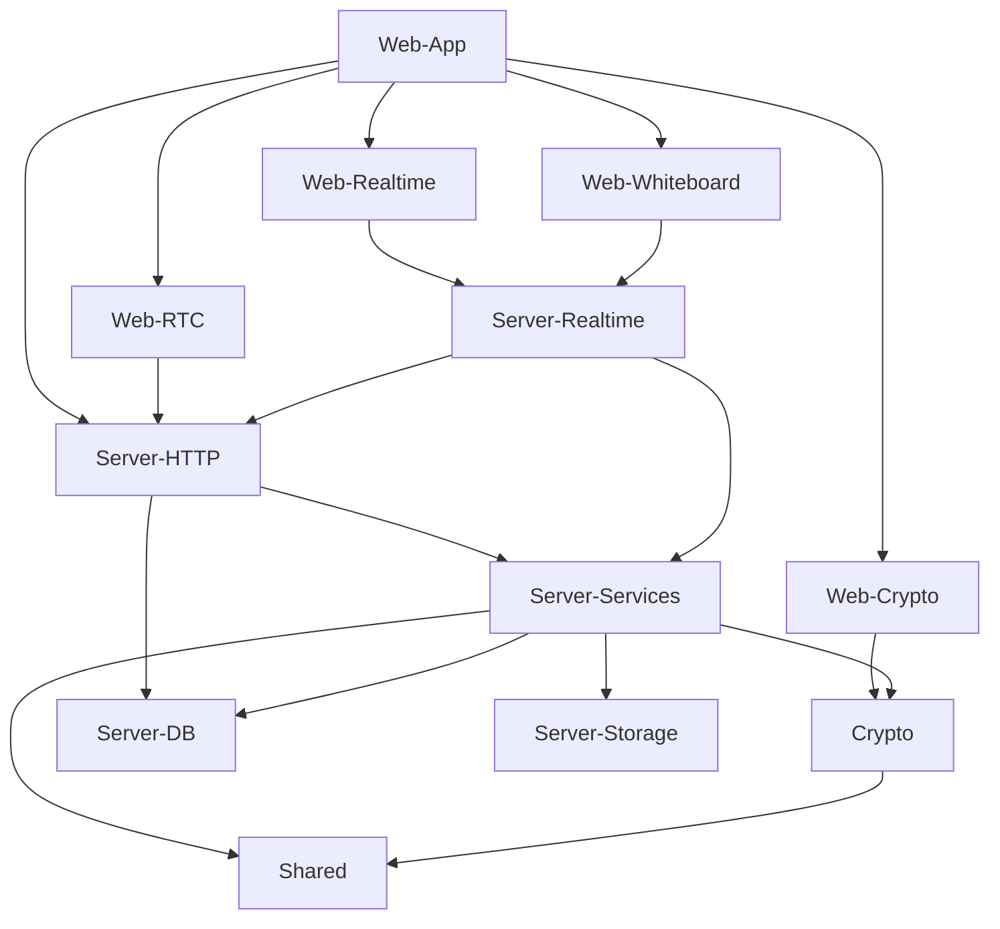

# CodeAlpha_RealTimeCommunicationApp — Architecture

## 1. Stack
- TypeScript, ESM (`"type": "module"` in every package.json), Node >=22.12.0, pnpm workspace (`packageManager: pnpm@10.5.1`)
- Web (`apps/web`): React 19, Vite, Tailwind CSS 4, Zustand, Socket.IO client, idb
- Server (`apps/server`): Express 5, Socket.IO, Mongoose, Argon2id (`@node-rs/argon2`), Zod, Pino, tsup (build)
- Crypto (`packages/crypto`): WebCrypto-based E2EE + hash-wasm

## 2. Directory map
| path | what lives there |
|---|---|
| apps/server | Express + Socket.IO backend (`@rtc/server`) |
| apps/server/src | main.ts, app.ts, config/, http/, realtime/, services/, db/, storage/, crypto/, scripts/, __tests__/ |
| apps/web | React SPA frontend (`@rtc/web`) |
| apps/web/src | App.tsx, main.tsx, styles.css, crypto/, realtime/, rtc/, whiteboard/, features/, stores/, components/, lib/ |
| packages/crypto | E2EE primitives library (`@rtc/crypto`) |
| packages/crypto/src | account.ts, identity.ts, dm.ts, group.ts, file.ts, fingerprint.ts, aead.ts, bytes.ts, aad.ts, index.ts, *.test.ts |
| packages/shared | Shared types/schemas/events (`@rtc/shared`) |
| packages/shared/src | ids.ts, result.ts, constants.ts, index.ts, schemas/, events/, domain/ |
| docs | ARCHITECTURE.md, SECURITY.md, RELIABILITY.md, WEBRTC.md, FEATURE_MAP.md, DEMO_SCRIPT.md |
| scripts | bootstrap-env.mjs |

## 3. Diagram

## 4. Component index
- [[Web-App]]
- [[Web-Crypto]]
- [[Web-Realtime]]
- [[Web-RTC]]
- [[Web-Whiteboard]]
- [[Server-HTTP]]
- [[Server-Realtime]]
- [[Server-Services]]
- [[Server-DB]]
- [[Server-Storage]]
- [[Crypto]]
- [[Shared]]

## 5. Entry points
- Dev server: `apps/server/src/main.ts` — run via `pnpm dev:server` → `tsx watch src/main.ts` (apps/server/package.json)
- Dev web: `apps/web/src/main.tsx` — loaded by `apps/web/index.html`, run via `pnpm dev:web` → `vite` (apps/web/package.json)
- Prod server: `apps/server/dist/main.js` — built by `tsup` from src/main.ts, started via `node dist/main.js` (apps/server/package.json `start` script)
- Prod web: static SPA build served single-origin by `apps/server/src/app.ts` (`env.SERVE_STATIC` branch → `express.static(env.WEB_DIST_DIR)`)

## 6. Conventions
- ESM everywhere: every package.json has `"type": "module"`; import specifiers use explicit `.js` extensions even from `.ts`/`.tsx` source (e.g. `./config/env.js` in apps/server/src/main.ts; `./crypto/session.js` in apps/web/src/App.tsx)
- Internal packages referenced as `"workspace:*"` (apps/server/package.json, apps/web/package.json, packages/crypto/package.json)
- pnpm pinned via `"packageManager": "pnpm@10.5.1"` (root package.json)
- Express middleware order in apps/server/src/app.ts: `requestId` → pino logger → security headers → compression/cookies/body parsers → `/api/health` → `/api/auth` (no CORS, by comment) → CORS+rate-limit for rest of `/api` → routes → `notFound` → `errorHandler` (last)
- Server bootstrap (apps/server/src/main.ts) connects the DB and warms the password hasher before opening the HTTP listener, then installs SIGTERM/SIGINT handlers that emit `server:draining` before closing sockets

## 7. Where things go
- New REST endpoint → add a route file under `apps/server/src/http/` and mount it in `apps/server/src/app.ts`
- New realtime/socket event → handler under `apps/server/src/realtime/`, client binding under `apps/web/src/realtime/`, shared event contract under `packages/shared/src/events`
- New E2EE primitive → module under `packages/crypto/src/` and export it from `packages/crypto/src/index.ts`
- New UI feature panel → folder under `apps/web/src/features/` and wire it into `apps/web/src/App.tsx`
- New shared type/schema → under `packages/shared/src/schemas` or `packages/shared/src/domain`, export via `packages/shared/src/index.ts`
