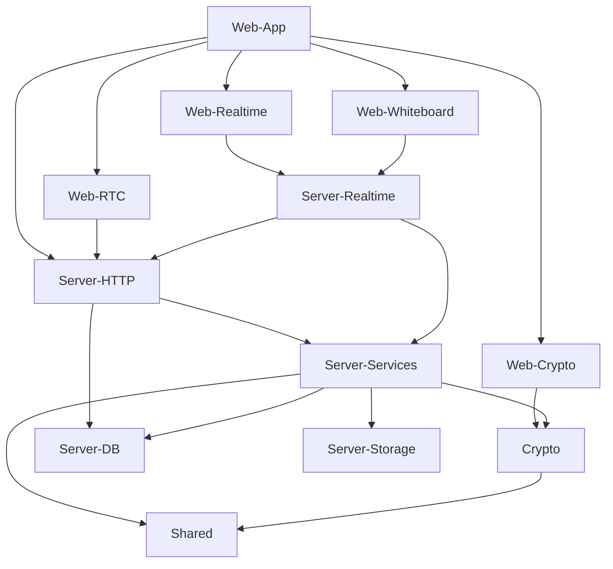

<div align="center">

# Cipher

**End-to-end encrypted team chat with multi-user video calling, screen sharing, encrypted file sharing and a collaborative whiteboard.**

## Architecture / How it Works




CodeAlpha Full Stack Internship · Task 4: Real-Time Communication App

`TypeScript` · `React 19` · `Express 5` · `Socket.IO` · `MongoDB` · `WebRTC` · `WebCrypto`

</div>

---

The server is a router and a filing cabinet. It authenticates, authorizes,
orders and stores — and it can decrypt none of the content it handles. Messages,
attachments (including their filenames), whiteboard strokes and group titles are
sealed in the browser before they leave it.

That constraint drives the whole design, and it has costs. They are documented
rather than hidden: no server-side search, no message previews on the
conversation list, no antivirus on attachments, and a forgotten password means
lost history unless you kept your recovery code.

## Quickstart

```bash
cp .env.example .env && pnpm setup && docker compose up --build
```

Open **http://localhost:8080** and use the one-click demo logins. Open a second
window for a second account to see delivery, calls and the whiteboard between
two people.

| Account | Password |
|---|---|
| `alice@demo.dev` | `demo1234` |
| `bob@demo.dev` | `demo1234` |
| `carol@demo.dev` | `demo1234` |

<details>
<summary>Local development with hot reload</summary>

```bash
pnpm install
pnpm setup          # generates .env with fresh secrets
pnpm dev            # starts MongoDB in Docker, seeds, runs API + Vite
```

Then open http://localhost:5173. The API runs on :4000 and Vite proxies to it.

```bash
pnpm typecheck      # all four packages
pnpm test           # 178 tests
pnpm test --project unit          # fast, no I/O
pnpm test --project integration   # real HTTP + Socket.IO + in-memory Mongo
```
</details>

## Prove the encryption is real

Don't take the claim on faith — read the database:

```bash
docker compose exec mongo mongosh rtc --quiet --eval \
  'JSON.stringify(db.messages.findOne({}, {envelope:1, senderId:1, seq:1}), null, 2)'
```

A sender, a sequence number, and an opaque envelope. No message text anywhere.

## What is built

| Requirement | Status |
|---|---|
| Real-time chat | Typing indicators, presence, read receipts, optimistic send, offline queue, reconnect backfill, per-author delete |
| Video calling (multi-user) | WebRTC mesh up to 4, perfect negotiation, adaptive bitrate, ICE restart |
| Screen sharing | Renegotiation-free via a pre-created transceiver |
| File sharing | Chunked client-side AES-256-GCM, membership-authorized streaming download |
| Whiteboard | Encrypted total-ordered op log, per-author undo, late-join replay, live cursors |
| Data encryption | Real E2EE: ECDH P-256 + HKDF + AES-256-GCM, per-sender ECDSA signatures, group key epochs |
| User authentication | Argon2id, rotating refresh tokens with reuse detection, CSRF, recovery codes |

## The parts worth reviewing

Rather than a feature tour, here are the decisions that took thought. Each links
to the code.

**Retrying a send cannot duplicate a message.** The message id is minted by the
client and never regenerated; a unique index on `(conversationId, clientMsgId)`
makes a replay a no-op. So retry is safe by construction, not by care.
→ [`message.service.ts`](apps/server/src/services/message.service.ts) · [`RELIABILITY.md`](docs/RELIABILITY.md)

**Two rapid sends from one socket could have rendered out of order — for
everyone.** Socket.IO dispatches in arrival order, but an `async` handler yields
at its first `await`, so two sends can interleave inside sequence allocation. A
per-`(socket, conversation)` mutex fixes it.
→ [`SerialQueue.ts`](apps/server/src/realtime/SerialQueue.ts)

**In a group, an AEAD tag proves nothing about who wrote a message.** Every
member holds the room key, so without a per-sender signature any member could
forge as any other. This is the single most common flaw in homegrown group
E2EE, and there is a test that fails if the signature is ever removed.
→ [`group.ts`](packages/crypto/src/group.ts) · [`messaging.test.ts`](packages/crypto/src/messaging.test.ts)

**Screen sharing toggles with zero renegotiation.** Three transceivers are
created up front, so sharing is one `replaceTrack` call. It also means incoming
tracks identify themselves positionally — no metadata message, so no race where
the track arrives first.
→ [`PeerLink.ts`](apps/web/src/rtc/PeerLink.ts) · [`WEBRTC.md`](docs/WEBRTC.md)

**Chunked AES-GCM is a footgun.** Each chunk authenticates perfectly on its own,
so without positional binding a truncated or reordered file still verifies.
Every chunk's AAD carries its index, the total count and the plaintext size.
→ [`file.ts`](packages/crypto/src/file.ts)

**Refresh-token reuse detection needs a grace window.** Two tabs can legitimately
present the same token; without a 10-second window, correct detection reads to
the user as "the app randomly logged me out".
→ [`auth.service.ts`](apps/server/src/services/auth.service.ts)

**One wrapper enforces every socket invariant.** Rate limit → validate → check
token → check membership → check joined → serialize → handle. A handler that
skips it is visibly anomalous in review, and a test asserts every declared event
is registered through it. That test found a real gap on its first run.
→ [`handler.ts`](apps/server/src/realtime/handler.ts)

**Things deliberately not built**, and why: AES-KW, searchable encryption,
CSFLE with a local KMS, a hand-rolled double ratchet, `sanitizeFilter`.
→ [`SECURITY.md § Security theatre we deliberately avoided`](docs/SECURITY.md)

## Documentation

| | |
|---|---|
| [ARCHITECTURE.md](docs/ARCHITECTURE.md) | System shape, data model, and the two schema decisions that carry the weight |
| [SECURITY.md](docs/SECURITY.md) | Threat model, what E2EE does *not* give you, security theatre avoided |
| [RELIABILITY.md](docs/RELIABILITY.md) | Exactly-once semantics stated precisely, ordering, reconnect |
| [WEBRTC.md](docs/WEBRTC.md) | Mesh math, perfect negotiation, the DTLS fingerprint caveat |
| [FEATURE_MAP.md](docs/FEATURE_MAP.md) | Every requirement mapped to its implementing file |
| [DEMO_SCRIPT.md](docs/DEMO_SCRIPT.md) | Six-minute walkthrough, doubles as manual QA |

## Known limits and deliberate tradeoffs

Naming your own limits is part of the design.

- **Calls cap at 4 participants.** Mesh uplink scales with `n-1`; at n=8 a client would need ~8.4 Mbps up. Beyond ~5, an SFU is the right answer.
- **No TURN relay by default**, so roughly 10–20% of real-world calls fail behind symmetric NAT. Invisible on localhost. `coturn` ships behind `--profile turn`.
- **Peer-to-peer calls reveal participants' IP addresses to each other.** Inherent to P2P; the call UI says so, and relay-only mode is available when TURN is configured.
- **MongoDB runs standalone**, so no transactions and sequence numbers have gaps. The protocol is gap-tolerant by design.
- **Single server instance.** Socket registries and rate limiters are in-memory; scaling out needs the Redis adapter. Drop-in, not built.
- **One identity key per account, not per device.** A lost device means rotating and rekeying every room.
- **No forward secrecy within a key epoch.** Rekeying on membership change bounds the blast radius; it is not a double ratchet, and MLS is the upgrade path.
- **The server serves the JavaScript**, which is the unfixable limit of browser-delivered E2EE.
- **The user directory lists every account** — fine for a demo, wrong for production.

## Deployment

`render.yaml` deploys the single-origin Docker image to Render's free tier with
MongoDB Atlas M0. Both are permanently free.

Note that Vercel **cannot** host this app's backend: its serverless functions
have no long-lived WebSocket connections and its rewrites do not proxy an HTTP
upgrade, so Socket.IO cannot run there. A single always-on service can.

Free-tier honesty: a Render free instance sleeps after ~15 minutes idle, so the
first request after a cold start takes 30–50 seconds.

## Licence

MIT
