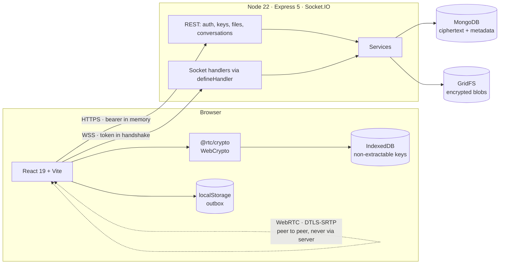

# Architecture

## Shape



The server is a **router and a filing cabinet**. It authenticates, authorizes,
orders and stores — and it can decrypt none of the content it handles. That
constraint drives most of the design decisions below.

## Repository layout

```
packages/shared/     the wire contract: branded ids, Ack<T>, limits,
                     ClientToServerEvents / ServerToClientEvents, Zod schemas
packages/crypto/     isomorphic WebCrypto core; pure, DOM-free, most-tested
apps/server/         Express 5 + Socket.IO + Mongoose
apps/web/            React 19 + Vite + Tailwind v4 + Zustand
```

`@rtc/shared` and `@rtc/crypto` export `./src/index.ts` **directly** rather
than a built `dist`. Vite transpiles them; the server runs under `tsx` in dev
and `tsup` inlines them for production. No build-order orchestration and no
stale `dist/` — the standard TypeScript-monorepo papercut, avoided
structurally.

`@rtc/crypto` is deliberately DOM-free in its public API (it takes
`Uint8Array`, not `Blob`) so the server's seed script can import it and encrypt
demo data exactly as a browser would.

## The typed contract

Every client→server event takes exactly `(payload, ack)`. No positional
arguments, no exceptions. That uniformity is what lets a single wrapper —
`defineHandler` — enforce, in order:

```
rate limit → Zod parse → token still valid → DB membership
→ socket joined → optional serialization → handler → error shaping → ack
```

The point is not convenience. It is that a handler which skips the wrapper is
**visibly anomalous in review** rather than an invisible hole in
authorization. An integration test walks the declared event list against what
is actually registered, so an event cannot ship without a validated handler.
That test caught a real gap on its first run.

Acks are a discriminated union carrying a `retryable` flag, so the client's
retry logic never has to guess.

Schemas are `.strict()`: unknown keys are **rejected, not stripped**. Silent
stripping hides client/server contract drift, and drift is where authorization
bugs live.

## Data model, and two decisions that carry the weight

| Collection | Key indexes |
|---|---|
| `users` | `{emailIndex}` unique · `{presence.status, presence.lastSeenAt}` |
| `conversations` | `{memberIds, lastMessage.createdAt}` · `{dmKey}` unique partial |
| `participants` | `{conversationId, userId}` unique · `{userId, conversationId}` |
| `messages` | `{conversationId, seq}` unique · `{conversationId, clientMsgId}` unique · `{conversationId, attachmentId}` sparse |
| `whiteboardOps` | `{conversationId, seq}` unique · `{conversationId, strokeId}` sparse |
| `epochs` | `{conversationId, epoch}` unique |
| `attachments` | `{conversationId, createdAt}` · `{messageId, createdAt}` sparse |
| `refreshTokens` | `{tokenHash}` unique · `{expiresAt}` TTL · `{userId, familyId}` |

**Participants are a separate collection, not a subdocument array.** Read
watermarks update on every receipt from every member; as an array that would
mean constantly rewriting the hot conversation document, contending with the
atomic `$inc` that allocates sequence numbers. Split out, each user's watermark
is an independent single-document update.

**Messages carry no `readBy` array.** In a group of *n* that is
O(messages × members) updates and unbounded growth on the hottest collection.
Receipts are watermarks; "read by 3" is derived by comparing two numbers
against the already-loaded participant list. Messages stay append-only and
immutable.

`{dmKey}` unique partial deserves a note: without it, two users clicking each
other at the same moment create two conversations, after which their messages
split across both and neither sees the full thread — a bug that is invisible in
testing and obvious in production.

`ensureIndexes` runs at boot and logs every index with its count. Indexes
declared in a schema but never actually built is a classic slow-burn failure:
everything works on a seeded dataset and degrades quietly under volume.

## What the server can and cannot see

The server stores a `CipherEnvelope` verbatim: salt, IV, ciphertext, a
per-sender signature and a key version. It never interprets any of it.

It *does* see routing metadata — membership, sequence numbers, sender ids,
timestamps — and that is unavoidable: encrypting a routing table you must read
would be theatre. Every one of those fields is bound into the AAD, so
tampering with them is **detectable** even though reading them is not
preventable.

Consequences accepted as part of the design, not oversights:

- **No server-side search.** Search is a client-side index over decrypted content. Deterministic or searchable encryption leaks word frequency and is broken by frequency analysis.
- **No message previews on the conversation list.** Denormalising a plaintext preview beside an encrypted body would leak exactly what the encryption protects. The list stores metadata only and clients render previews from their local cache.
- **No server-side antivirus on attachments.** You can have E2EE files or server-side AV, not both.

## Deployment

Single origin: one process serves the SPA, the REST API and Socket.IO. That is
what makes `__Host-` cookies, `SameSite=Strict` and a `'self'`-only CSP work
without exceptions. Almost every "my httpOnly cookie doesn't work" bug in this
stack is a two-origin bug, so the deployment removes the second origin.

`ALLOWED_ORIGINS` and cookie `SameSite` are environment-driven, so a split
topology remains a configuration change rather than a refactor.

## Known limits and deliberate tradeoffs

- **Mesh calls cap at 4.** Beyond that an SFU is required — see `WEBRTC.md`.
- **No TURN by default**, so ~10–20% of real-world calls fail behind symmetric NAT. Invisible on localhost. `coturn` ships behind a compose profile.
- **MongoDB standalone**, so no transactions and sequence numbers have gaps. The protocol is gap-tolerant by design — see `RELIABILITY.md`.
- **Single server instance.** The socket registries and rate limiters are in-memory; scaling out needs the Redis adapter and a Redis rate-limit store. Both are drop-in, neither is built.
- **One identity key per account, not per device.** A lost device means rotate and rekey.
- **The user directory lists every account.** Fine for a demo; a real deployment wants invitations or scoped search.
- **No push notifications.** They would be content-free anyway, since the server cannot read messages.
